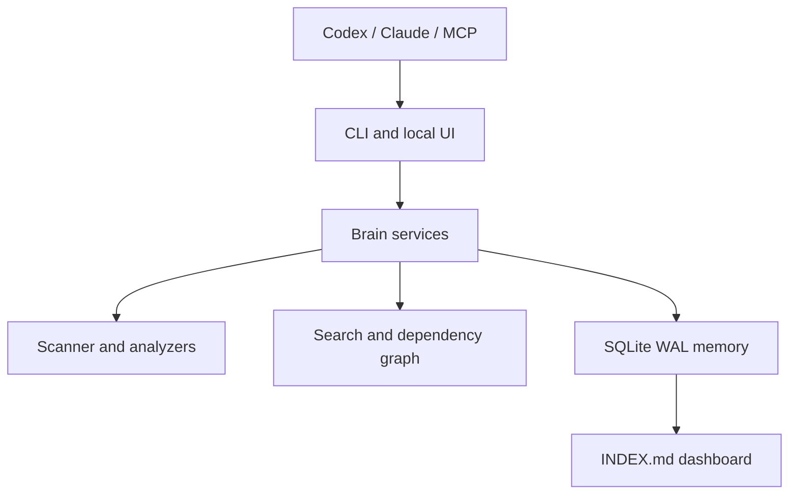

# Repo Brain

Persistent repository memory for coding agents — Codex, Claude Code and MCP.

Repo Brain builds a local, auditable SQLite map of a codebase: file locations, hashes, symbols, dependencies, analyses, reads, decisions, plans and changes. It answers “where should I look?” quickly while making stale memory visible.

> Memory guides discovery. Current source code determines truth.

## Quick start

```bash
pip install .
cd my-project
repo-brain install --all
repo-brain init
repo-brain context "change password reset expiration"
repo-brain read src/auth/password_reset.py
repo-brain ui # open http://127.0.0.1:8765
```

The database is shared across Git worktrees at `<git-common-dir>/repo-brain/brain.db`; non-Git projects use `.repo-brain/brain.db`. Confirm it with `repo-brain db path`.

## Architecture



Offline-first: no API key, telemetry, SaaS, or source upload is required. FTS5 is used when available, with a deterministic fallback. Secrets and full source contents are not stored in the database.

## Commands

`init`, `scan`, `status`, `coverage`, `context`, `search`, `read`, `symbols`, `deps`, `dependents`, `impact`, `analyze`, `session`, `plan`, `decision`, `reads`, `changes`, `bootstrap`, `export`, `import`, `doctor`, `db`, `mcp serve`, and `ui` are available. Add `--json` for automation.

## MCP

`repo-brain mcp serve` exposes `brain_context`, `brain_read_file`, `brain_impact`, search, sessions, plans, decisions, bootstrap and refresh tools over stdio. An optional `mcp` extra is documented for hosts that want the official Python SDK; the fallback server keeps the core offline and dependency-light.

## Multi-agent and stale safety

SQLite WAL, foreign keys, busy timeouts and short transactions support concurrent agents. A changed hash makes the current analysis `stale`; direct dependents can be `needs_review`. Always read the current file before editing and refresh its analysis afterward.

## Development

```bash
python -m venv .venv
.venv/Scripts/activate  # Windows; use bin/activate on Unix
pip install -e '.[dev]'
pytest
python -m build
```

See [docs/ARCHITECTURE.md](docs/ARCHITECTURE.md), [docs/DATABASE.md](docs/DATABASE.md), [docs/MCP.md](docs/MCP.md), [docs/CODEX.md](docs/CODEX.md), and [docs/CLAUDE.md](docs/CLAUDE.md).

Licensed under Apache-2.0.

